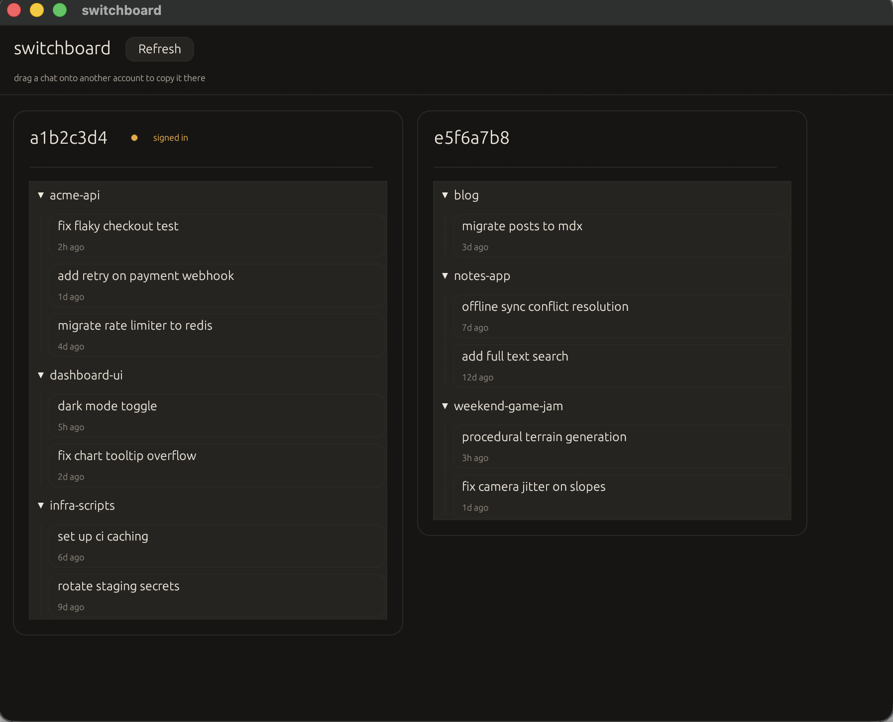

# switchboard

A small native app for moving Claude Desktop chats between accounts. Drag a chat from one account's column onto another and it copies over.



## Why

Claude Desktop keeps chat history scoped to whichever account is signed in. Switching accounts on the same machine means switching chat history too, there's no built in way to carry a conversation across. switchboard reads the local session data directly, lists every account it finds grouped by project folder, and lets you drag chats between them.

Nothing leaves your machine. It only reads and writes the local Claude Desktop session files.

## Install

Download the latest build for your platform from [Releases](https://github.com/Udhay-Adithya/switchboard/releases). The macOS build is signed and notarized, so it opens normally.

Or build it yourself:

```bash
git clone https://github.com/Udhay-Adithya/switchboard.git
cd switchboard
cargo run --release
```

## Usage

Open switchboard while Claude Desktop is installed. Each column is one account, with its chats grouped by project folder underneath. Drag a chat card onto another account's column to copy it there. A chat already present and up to date in the destination is left alone; an older copy is replaced with the richer one.

To try it with sample data instead of your real accounts:

```bash
cargo run --release -- --demo
```

## How it works

Claude Desktop stores a small per-account, per-organization index of chat sessions under `~/Library/Application Support/Claude/claude-code-sessions/`. switchboard scans every account it finds there, cross-references `~/Library/Logs/Claude/main.log` to work out which organization folder is actually signed in for each account, and copies the relevant session pointer file when you drop a chat on another account. It never touches the underlying transcript files, which are shared storage independent of any account.

## License

MIT
